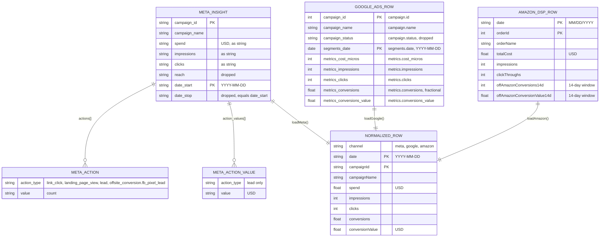
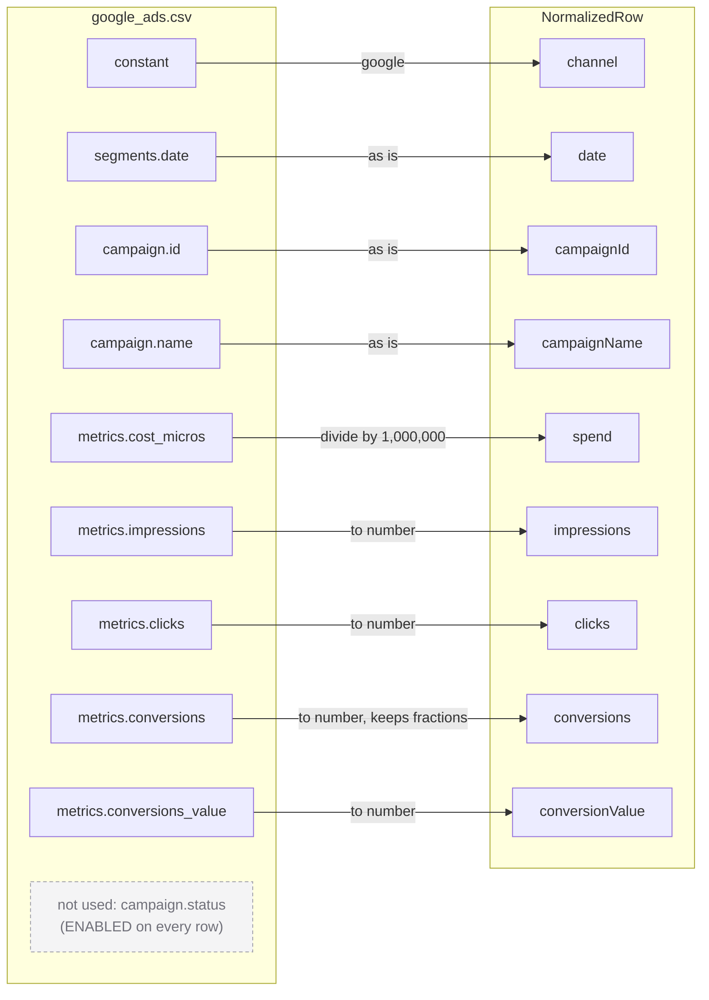

# AI transcript — ADBOX Dashboard Product Engineer

Export of the Cursor agent chat used to build the Harbor Point Bank dashboard (`19e1c6dc-7fed-48eb-8476-f97450145c99`).

- **Session:** Friday, Nov 13, 2026, ~2:40 PM–4:20 PM PT (~1 hour 40 minutes)
- User prompts and assistant replies included; tool calls summarized by name
- Large pasted Lighthouse JSON truncated; paths/usernames scrubbed as `[removed]`

---

## Turn 1 — Friday, Nov 13, 2026, 2:40 PM (UTC-8)

### User

read the context of this file and start there

### Assistant

*Tools used:* Shell, Read×3, Shell×3, AskQuestion, Shell×4, Read×3, Write, StrReplace, Shell×2, GetDynamicTools, cursor-ide-browser/browser_navigate, cursor-ide-browser/browser_take_screenshot, Shell×2

No file was attached, so I'll check the workspace for a context or README file.

I've read the brief. Next I'm looking at the three data files so the plan is grounded in what's actually in them.

A few quick data-quality checks before I propose a plan: duplicate rows, whether the two Meta lead actions are always equal, row counts per campaign, and date ranges.

You picked Next.js and git, so I'll scaffold a basic Next.js app in the empty `addPlatformDemo/` folder and set up the git repo at the workspace root, so the data files and brief are tracked too.

npm package names can't contain capital letters, so I'll scaffold under a lowercase name and then rename the folder back to `addPlatformDemo`.

The sandbox blocked the scaffolder's write check, so I'm rerunning it with full permissions.

The scaffold created an `AGENTS.md`, which may have instructions for working in this version of Next, so I'll read it along with the generated page and layout.

Next I'm checking it: lint and a production build, then I'll start the dev server.

The page renders correctly. Now I'm setting up git at the workspace root and making the first commit.

The commit doesn't list `package-lock.json`, and a lockfile should be tracked, so I'm checking why.

The basic Next.js dashboard page is set up in `addPlatformDemo/`, committed to a new git repo, and running at http://localhost:3000. Lint and a production build both pass.


**What's there now:**
- Next.js 16, TypeScript and Tailwind, created with `create-next-app`. npm doesn't allow capital letters in package names, so the package is called `adbox-dashboard`, but the folder is still `addPlatformDemo/`.
- `src/app/page.tsx` is a static layout with a header, filter placeholders, four summary cards (Spend, Conversions, CPA, ROAS), and labelled boxes where the chart, the totals table and the unmatched/ambiguous campaigns list will go. No data is loaded yet.
- Git is set up at the workspace root, so the brief and data files are in the repo too, with one commit: "Scaffold Next.js dashboard shell with assessment data".

**Two things worth knowing:**
- **The lockfile isn't committed.** Your global gitignore excludes `package-lock.json`. Reviewers have to run this in under 5 minutes, so committing it would pin their install to your versions. I didn't override your setting; `git add -f addPlatformDemo/package-lock.json` adds it if you want.
- **This is a new Next.js.** The scaffold added an `AGENTS.md` warning that version 16 has breaking API changes. I'll check the bundled docs in `node_modules/next/dist/docs/` before writing data-loading code.

When you're ready for the data work, the main decisions are which Meta action counts as a conversion, how to treat the `TEST - do not report` campaign, and how to handle the "Fall Promo Checking Launch Combo Search" campaign. That last one is the one named to look like it belongs to both Fall Rate Promo and Checking Account Launch.

---

## Turn 2 — Friday, Nov 13, 2026, 2:45 PM (UTC-8)

### User

@addPlatformDemo/src create a data injest file

### Assistant

*Tools used:* Shell, Write, Shell×2

I'll add an ingest module in `src/lib/` that turns all three exports into one normalized row type. First I'm checking the CSVs for quoted fields, which would decide whether a simple split-based parser is safe.

Neither CSV has quoted fields, and every row has the same number of columns, so splitting on commas is safe. The parser will throw if a row's column count ever differs. Writing the ingest file now:

Now I'm checking the output against an independent Python calculation done straight from the raw files.

I added `addPlatformDemo/src/lib/ingest.ts`, which loads all three exports into one row type. I checked it against a separate Python script reading the raw files, and every channel matches exactly:

| Channel | Rows | Spend | Conversions | Conv. value |
|---|---|---|---|---|
| Meta | 428 | $121,763.48 | 5,544 | $237,805.99 |
| Google | 480 | $126,813.00 | 26,517.49 | $327,649.69 |
| Amazon | 240 | $75,159.73 | 169 | $94,787.12 |

Impressions and clicks match too. All three channels cover Aug 1 to Sep 29, the type check and lint pass, and it's committed.

Every row has the same fields: `channel`, `date` (YYYY-MM-DD), `campaignId`, `campaignName`, `spend`, `impressions`, `clicks`, `conversions` and `conversionValue`, with money in USD. `loadAllRows()` returns everything; `loadMeta`, `loadGoogle` and `loadAmazon` return one channel each.

How each source is handled:
- **Google:** `cost_micros` is divided by 1,000,000 to get dollars. Fractional conversions are kept as they are.
- **Amazon:** dates are converted from MM/DD/YYYY to YYYY-MM-DD. The 14-day-window conversions are used as reported, and a comment in the code says so.
- **Meta:** conversions and conversion value both come from the `lead` action. `link_click` is ignored because `clicks` already holds the same number.
- **Bad input fails loudly:** a non-numeric value, a malformed date or a CSV row with the wrong column count throws an error instead of quietly becoming zero.

**Decision for you:** you'd set aside the Meta conversion question, but the loader needed some answer, so I used `lead`. It's the only action with a value in `action_values`, and counting `offsite_conversion.fb_pixel_lead` as well would double conversions. It's one constant, `META_CONVERSION_ACTION`, so it's easy to change if you decide otherwise.

The loader reads the data files from the folder above the app (`path.join(process.cwd(), "..")`), so it only works when the app runs from `addPlatformDemo/`. Nothing calls it yet; connecting it to the page and campaign matching are the next steps.

---

## Turn 3 — Friday, Nov 13, 2026, 2:47 PM (UTC-8)

### User

can you print out the structure of each file format so i can look and see what the systems look like

### Assistant

*Tools used:* Shell

I'll print one real raw record from each file, plus the column or field list, so you can compare the three platforms side by side.

Below is one real record from each file, then a table showing how each platform's fields map onto the normalized row in `ingest.ts`.

**Meta: `meta_insights.json`.** This is JSON with a `data` array and a `paging` cursor, like the Graph API returns. There are 428 rows, one per campaign per day.

```json
{
  "campaign_id": "31480986460544234",
  "campaign_name": "Fall Rate Promo - Prospecting",
  "spend": "332.57",
  "impressions": "53639",
  "clicks": "600",
  "reach": "40962",
  "actions": [
    { "action_type": "link_click", "value": "600" },
    { "action_type": "landing_page_view", "value": "480" },
    { "action_type": "lead", "value": "15" },
    { "action_type": "offsite_conversion.fb_pixel_lead", "value": "15" }
  ],
  "action_values": [{ "action_type": "lead", "value": "873.67" }],
  "date_start": "2026-08-01",
  "date_stop": "2026-08-01"
}
```

Every number is a string. Conversions sit inside the `actions` list and have to be picked out by `action_type`, and their value sits in a separate `action_values` list. The file ends with `"paging": { "cursors": { "before": "MAZDZD", "after": "MjQZD" } }`.

**Google Ads: `google_ads.csv`.** This is a flat CSV with dotted column names, like a GAQL report. There are 480 rows, one per campaign per day.

```
campaign.id                 43800084505
campaign.name               FALL_RATE_PROMO_Search_Brand
campaign.status             ENABLED
segments.date               2026-08-01
metrics.cost_micros         221200000      ← $221.20
metrics.impressions         20864
metrics.clicks              1065
metrics.conversions         117.66         ← fractional
metrics.conversions_value   993.06
```

**Amazon DSP: `amazon_dsp.csv`.** This is a flat CSV with camelCase names. There are 240 rows, one per order per day.

```
date                          08/01/2026   ← MM/DD/YYYY
orderId                       3779101165048
orderName                     fallrate-display-Q3-26
totalCost                     191.79
impressions                   21277
clickThroughs                 76
offAmazonConversions14d       1            ← 14-day attribution
offAmazonConversionValue14d   340.14
```

**How each field maps to the normalized row:**

| Normalized | Meta | Google Ads | Amazon DSP |
|---|---|---|---|
| `date` | `date_start` | `segments.date` | `date`, converted from MM/DD/YYYY |
| `campaignId` | `campaign_id` | `campaign.id` | `orderId` |
| `campaignName` | `campaign_name` | `campaign.name` | `orderName` |
| `spend` | `spend` | `metrics.cost_micros` ÷ 1,000,000 | `totalCost` |
| `impressions` | `impressions` | `metrics.impressions` | `impressions` |
| `clicks` | `clicks` | `metrics.clicks` | `clickThroughs` |
| `conversions` | the `lead` entry in `actions` | `metrics.conversions` | `offAmazonConversions14d` |
| `conversionValue` | the `lead` entry in `action_values` | `metrics.conversions_value` | `offAmazonConversionValue14d` |

Some fields aren't carried over. Meta's `reach`, `date_stop`, `landing_page_view` and `link_click` are dropped; `link_click` is just a copy of `clicks`. Google's `campaign.status` is dropped too. It's `ENABLED` on every row, but it could be worth keeping if you later want to show paused campaigns.

---

## Turn 4 — Friday, Nov 13, 2026, 2:49 PM (UTC-8)

### User

lets build and add a mermade diagram with the table structure and data structure for each and how each collum is translated to the normailzed context

### Assistant

*Tools used:* Read, Write, Shell, cursor-ide-browser/browser_navigate, Shell, cursor-ide-browser/browser_navigate, cursor-ide-browser/browser_cdp, cursor-ide-browser/browser_take_screenshot, Shell

To make sure the four diagrams actually render, I'm loading them with Mermaid in a temporary page in the browser.

All four diagrams parse and render. I'm cleaning up the temporary server and committing.

I added `docs/data-model.md` with four Mermaid diagrams. I rendered them all with Mermaid 11 and they parse and draw correctly, and the doc is committed.

The doc has:
- **Schema diagram:** each raw format as a table with types and its key (campaign ID plus date). Meta's nested `actions[]` and `action_values[]` lists are shown as their own child tables, and all three sources point at `NORMALIZED_ROW`.
- **Three mapping diagrams, one per platform:** each source column has an arrow to its normalized field, labelled with the conversion applied. Fields that aren't used appear as a greyed, dashed box with the reason.

Here's the schema diagram:



Here's the Google mapping as an example; Meta and Amazon follow the same layout in the doc:



The doc ends with two short notes you can reuse in the design doc. First, bad input fails at load time instead of turning into zero. Second, attribution windows aren't harmonized: Amazon counts conversions over a 14-day window while Meta and Google use their own defaults, so cross-channel CPA and ROAS compare numbers counted differently.

---

### Assistant

The "aborted" status is expected: that was the temporary server I used to check the Mermaid diagrams, and it stopped when I shut it down after the check. Its folder is deleted too, so there's nothing to follow up on. The Next.js dev server is still running at http://localhost:3000.

---

## Turn 5 — Friday, Nov 13, 2026, 2:52 PM (UTC-8)

### User

can you export all the diargams for me

### Assistant

*Tools used:* Shell, Read×2, Shell

I'll export each diagram to SVG and PNG in `docs/diagrams/`, using the Mermaid CLI.

All four rendered. I'm checking a couple of the PNGs to confirm they look right.

Both look clean. Committing the exports:

All four diagrams are exported to `docs/diagrams/` and committed:

| Diagram | Files |
|---|---|
| Source schemas and the normalized row | `schema.svg`, `schema.png`, `schema.mmd` |
| Meta column mapping | `meta-mapping.svg`, `.png`, `.mmd` |
| Google Ads column mapping | `google-mapping.svg`, `.png`, `.mmd` |
| Amazon DSP column mapping | `amazon-mapping.svg`, `.png`, `.mmd` |

The SVGs scale cleanly for a PDF design doc. The PNGs are rendered at 2× on a white background, which is easier to paste into Google Docs or slides. The `.mmd` files are the Mermaid source pulled from `docs/data-model.md`, in case you want to edit them on mermaid.live.

Here are the schema and the Meta mapping:


The images don't update automatically. If you edit the diagrams in `data-model.md`, the exports need to be regenerated, which I can do on request.

---

## Turn 6 — Friday, Nov 13, 2026, 2:55 PM (UTC-8)

### User

we are going to remove channel and have it baked into the campaign id with it changed to ExternalCampainID and it will be ${shortChannel}/{extrnalId} then re do these diagrams

### Assistant

*Tools used:* Read, StrReplace×5, Read, StrReplace×5, Shell×2, Read×2, Shell, Read×3, Shell

I'll replace `channel` and `campaignId` with one `externalCampaignId` field in the form `{shortChannel}/{externalId}`, and add a helper that reads the channel back out, since the channel filter will still need it. After that I'll update the doc and regenerate the diagrams.

Now the doc. In the schema diagram, `channel` and `campaignId` collapse into `externalCampaignId`. In each mapping diagram, the channel prefix and the platform ID now both point to that one field.

Next I'm updating the node lists in the three mapping diagrams: dropping the old `channel` node, relabelling the ID node, and renaming the "constant" source box to "channel".

Now I'm re-checking the ingest output, running the type check and lint, and regenerating every export.

All three now read straight across in field order. Committing:

---

## Turn 7 — Friday, Nov 13, 2026, 2:57 PM (UTC-8)

### User

we want to also build out another file in the lib for normailzed campaign name with an id and the name in the object

### Assistant

*Tools used:* Shell, Write, Shell×2

Each of the 20 IDs has exactly one name. A campaign renamed on the platform would have more than one, so the builder will keep the name from its latest date.

I added `addPlatformDemo/src/lib/campaigns.ts`. It turns the normalized rows into a list of 20 campaign objects, one per `externalCampaignId`:

```ts
{ id: "gads/94895644729", name: "FallRatePromo_Search_NonBrand_2026", normalizedName: "fall rate promo search non brand 2026" }
```

- **`normalizeCampaignName()`** splits camelCase words, lowercases everything, and turns any run of `_ - | ( )` or spaces into a single space. That makes `FALL_RATE_PROMO_Search_Brand` and `FallRatePromo_Search_NonBrand_2026` both start with `fall rate promo`.
- **`buildCampaigns(rows)`** returns the campaigns sorted by ID. All 20 IDs currently have one name each; if a campaign is ever renamed on the platform, the name from its latest date wins.

I ran it on the real data, and the type check and lint pass. It only cleans up formatting, so these still differ and the matching step will have to handle them:
- **Abbreviations:** `chk launch` and `checking acct launch`, `he spring` and `home equity spring`.
- **Run-together words:** `fallrate` (Amazon) and `homeequity` (Amazon).
- **Typo:** `fal rate promo` (Meta).
- **Leftover tokens:** years and quarters (`2026`, `q3 26`), the `hpb` prefix, and `PMax`, which comes out as `p max`.

That's deliberate: keeping the cleanup general and leaving the initiative rules to the matching step keeps each piece easy to explain.

The previous change is done too. `channel` and `campaignId` are now one `externalCampaignId` field in the form `{shortChannel}/{id}`, using `meta`, `gads` and `amzn`, and `channelOf()` reads the channel back out. Spend totals are unchanged, and all four diagrams are regenerated. The mapping diagrams now show the ID going straight across with "prefix gads/" (or `meta/`, `amzn/`) on the arrow. Both changes are committed.

---

## Turn 8 — Friday, Nov 13, 2026, 3:00 PM (UTC-8)

### User

now we will use the normalized campaingns object to apply an internal-campaign id to the normilzed obj

### Assistant

*Tools used:* Write×3, Shell×2

I'll treat the three initiatives as internal campaigns with stable IDs. Each `Campaign` will get an `internalCampaignId` and a match status, and rows can join to it through `externalCampaignId`. The setup has three parts:

- **Initiative definitions:** each initiative's ID, display name and the name patterns that identify it, in `src/config/`.
- **Manual overrides:** a config file mapping an `externalCampaignId` to an initiative, for names the patterns can't handle.
- **Matching:** `src/lib/matching.ts` applies the overrides first, then the patterns. A campaign hitting two initiatives is marked ambiguous, not guessed.

Now I'm running the matcher on the real campaigns. I'm using `tsx` because it understands the project's `@/` import paths.

Every campaign lands where expected, and each initiative appears on all three platforms, which matches what `initiatives.md` says. Committing:

Each campaign now gets an `internalCampaignId` for its initiative. On the real data, 15 campaigns match automatically and one matches through a manual override. One campaign is ambiguous and four are unmatched, and all five are kept and labelled instead of dropped or guessed. The type check and lint pass, and it's committed.

| Initiative (`internalCampaignId`) | Meta | Google | Amazon |
|---|---|---|---|
| `fall-rate-promo` | 3 (one via override) | 2 | 1 |
| `checking-account-launch` | 2 | 2 | 1 |
| `home-equity-spring` | 1 | 2 | 1 |

- **Ambiguous:** `Fall Promo Checking Launch Combo Search` (Google) matches both Fall Rate Promo and Checking Account Launch, so `internalCampaignId` is `null` and `candidates` lists both IDs.
- **Unmatched:** `Recruiting - Careers Page`, `Branch Locator - Search`, `Evergreen Brand Engagement` and `TEST - do not report`.

**How it works.** Matching runs on the cleaned-up `normalizedName`:
1. **Override first:** if `src/config/campaignOverrides.ts` has an entry for the campaign's ID, that wins, with status `manual`. Entries are keyed by `externalCampaignId` rather than name, so renaming a campaign on the platform doesn't break them. Each entry carries a `reason`, and an override pointing to an initiative that doesn't exist throws an error.
2. **Patterns next:** each initiative in `src/config/internalCampaigns.ts` has a few patterns. Exactly one hit gives `auto`, more than one gives `ambiguous`, and none gives `unmatched`.

The candidate list is filled in even when an override applies, so you can tell whether the override agrees with the patterns.

A `MatchedCampaign` is the `Campaign` object plus three fields:
```ts
{ id, name, normalizedName, internalCampaignId: string | null, matchStatus: "auto" | "manual" | "ambiguous" | "unmatched", candidates: string[] }
```

**Decisions for you:**
- **Rows aren't stamped yet.** I put `internalCampaignId` on the campaign objects, not on every daily row, because rows can look it up by `externalCampaignId`. If you meant stamping it onto each row, it's a small step to add.
- **Typo handled by override.** I could have loosened the pattern to catch `Fal Rate Promo - Lookalike`, but I used the override file instead. A pattern that loose could quietly match the wrong campaign later, and this case exercises the manual-mapping path the brief asks for.
- **Two buckets still deferred:** the ambiguous combo campaign has no override, and `TEST - do not report` is treated as a normal unmatched campaign. Adding an `excluded` status for TEST would let it sit in its own bucket while still counting toward the grand total.

---

## Turn 9 — Friday, Nov 13, 2026, 3:02 PM (UTC-8)

### User

now pull this data structure into the next web page

### Assistant

*Tools used:* Shell, Read, Write×2, Shell, cursor-ide-browser/browser_navigate, cursor-ide-browser/browser_take_screenshot, cursor-ide-browser/browser_scroll, cursor-ide-browser/browser_take_screenshot, StrReplace, Shell×2

I'll connect the loaders to the page as a server component that reads the files on the server. This Next version has Cache Components turned on, so I'm checking its docs on how server-side data reads behave before wiring it up.

Now I'm running the type check, lint and a production build to confirm the page prerenders with the data.

The build passes and `/` is prerendered as static content. Next I'm checking the running dev server in the browser.

The summary totals match the ingest check: $323,736 in spend and 32,230 conversions. Scrolling down to the campaign table:

The table renders correctly. "Amazon DSP" wraps onto two lines, so I'm keeping the channel name on one line, then committing.

The edit and the commit ran at the same time, so I'm checking that the one-line fix actually made it into the commit.

The page now shows real data. The summary cards read $323,736 spend, 32,230 conversions, $10.04 CPA and 2.04× ROAS, which match the totals from the ingest check. Below them, a new campaigns table lists all 20 campaigns with their initiative. The type check, lint and production build pass, and it's committed.


- **`src/lib/dashboardData.ts`:** a new `loadDashboardData()` returns `{ rows, campaigns, internalCampaigns }`, so the page has one entry point to the data. The objects are plain data, so the same structure can be passed to the interactive filter and chart components later without changes.
- **`page.tsx`:**
  - **Server-side loading:** the page calls `loadDashboardData()` on the server. Because the inputs are static files, Next prerenders the page at build time with the data in it, so the browser never parses the CSVs.
  - **Summary cards:** CPA and ROAS are computed from the summed totals, not by averaging rates.
  - **Campaigns table:** rows are ordered by initiative, then match status, then spend. It shows the channel, campaign name, external ID, spend and a coloured status badge (Auto, Manual, Ambiguous, Unmatched). The ambiguous campaign reads "Fall Rate Promo or Checking Account Launch?", and unmatched campaigns show "None".
- **Still placeholders:** the filters, the chart and the totals table by initiative and channel. The data for all three is already loaded on the page; they just aren't built yet.

The summary cards include every campaign: unmatched ones like Recruiting, the ambiguous combo campaign and `TEST - do not report`. That fits the brief's rule that initiatives plus unmatched and ambiguous campaigns sum to the grand total. Whether TEST should sit in a separate excluded bucket is still your call.

---

## Turn 10 — Friday, Nov 13, 2026, 3:04 PM (UTC-8)

### User

do we have a static list of champains and where?

### Assistant

No, there's no static list of the 20 platform campaigns. They're rebuilt from the data rows every time the page loads:

```20:31:addPlatformDemo/src/lib/campaigns.ts
export function buildCampaigns(rows: NormalizedRow[]): Campaign[] {
  const latest = new Map<string, { name: string; date: string }>();
  for (const row of rows) {
    const seen = latest.get(row.externalCampaignId);
    if (!seen || row.date > seen.date) {
      latest.set(row.externalCampaignId, { name: row.campaignName, date: row.date });
    }
  }
  return [...latest]
    .map(([id, { name }]) => ({ id, name, normalizedName: normalizeCampaignName(name) }))
    .sort((a, b) => a.id.localeCompare(b.id));
}
```

The only hard-coded lists are in `addPlatformDemo/src/config/`:

- **`internalCampaigns.ts`:** the three initiatives, `fall-rate-promo`, `checking-account-launch` and `home-equity-spring`, each with a display name and its name patterns.
- **`campaignOverrides.ts`:** the manual mappings. It has one entry, which maps the Meta typo campaign `meta/28637003708194310` to `fall-rate-promo`.

Building the list from the data means a new campaign shows up on the dashboard automatically, as unmatched if its name doesn't fit a pattern. The catch is that nothing records which campaigns are expected. If a campaign stopped appearing in an export, it would just disappear from the dashboard with no warning. A static list in `src/config/` would let us flag both cases: a campaign we've never seen, and one that's missing from the data.

---

## Turn 11 — Friday, Nov 13, 2026, 3:06 PM (UTC-8)

### User

we want to build the full list as we go and import data so we only loop though each row once

### Assistant

*Tools used:* Read, StrReplace×4

Right now the rows are walked several times: once to normalize them, again in `buildCampaigns()` to build the campaign list, and twice more on the page for the totals and per-campaign spend. I'll collapse that into a single pass:

- **Loaders yield one row at a time:** `loadMeta`, `loadGoogle` and `loadAmazon` become generators, and the CSV parser does too. Each raw record is read and normalized once, with no intermediate arrays.
- **One import loop:** each normalized row is stored and also added to a campaign collector, which creates the campaign the first time its ID appears.
- **Totals collected in the same pass:** each campaign keeps running totals for spend, impressions, clicks, conversions and conversion value, so the page sums 20 campaigns instead of looping over the rows again.

---

## Turn 12 — Friday, Nov 13, 2026, 3:07 PM (UTC-8)

### User

cancel

### Assistant

*Tools used:* Shell

I've stopped and undone the partial edit, so `ingest.ts` matches the last commit and the working tree is clean. The page and loaders work as they did before you asked for the single-pass change.

If you come back to it, the plan was: loaders that yield one row at a time, a single import loop that adds each row to the campaign list as it goes, and running totals kept on each campaign.

---

## Turn 13 — Friday, Nov 13, 2026, 3:09 PM (UTC-8)

### User

what way would be beter to do 1) get and load the champains as we normilze needing to do it three ways  or after normilizing and thus only need to do it on our data and mark down in the read me

### Assistant

*Tools used:* Read, StrReplace, Shell×2

Option 2 is better: build the campaign list once, after normalizing. That's how the code already works, so nothing needs to change. I'll add the reasoning to the README.

Why building after normalization wins:

- **One implementation instead of three:** campaign building reads only `externalCampaignId`, `campaignName` and `date`, which every normalized row has. Doing it in each loader means three copies of the same logic, and three places for a rule like "latest name wins after a rename" to drift apart.
- **Adding a fourth platform stays small:** a new platform only needs a loader that produces normalized rows, and campaign building and matching work on it unchanged. The brief explicitly checks that a new platform is a small addition.
- **Loaders keep one job:** each loader only turns raw platform data into normalized rows. Its output can be checked against the raw file, as we did with the Python comparison, without campaign logic mixed in.
- **The extra pass costs almost nothing:** it's one more loop over about 1,150 rows. In production, the campaign list would come from a single query over the normalized table, which is this same design.

Option 1 only pays off when you can't hold the rows in memory at once, such as streaming a large backfill. Even then, the clean version is one shared collector called from a single loop, not logic copied into each loader. That's the change I'd started before you cancelled.

Your global gitignore excludes the lockfile, so `git status` won't show it either way. More to the point, the root `README.md` is ADBOX's brief, so I'll add a short section at the end of it rather than change their text.

I wrote the decision into the README and committed it. Option 2 is the better choice: build the campaign list once from the normalized rows, after normalization. That's already how the code works, so no code changed.

The new **Build decisions** section is at the end of the root `README.md`, after ADBOX's brief text, which I left alone. It records the reasons:
- **One implementation:** a single campaign builder instead of three copies that could drift apart.
- **New platforms are cheap:** a fourth platform only needs a loader that produces normalized rows.
- **Loaders stay simple:** each one only converts raw data, so it can be checked against its raw file.
- **The cost is tiny:** one extra loop over about 1,150 rows.

It also notes when to revisit: only if the rows ever get too large to hold in memory. Even then, the fix would be one shared collector in a single import loop, not campaign logic in each loader.

That root README is also where the time you spent needs to go at the top for the submission. The design doc can pull this section in nearly word for word.

---

## Turn 14 — Friday, Nov 13, 2026, 3:10 PM (UTC-8)

### User

also make a note that these would be stored in a DB as well so they could be accesed easily as we go

### Assistant

*Tools used:* StrReplace, Shell

I'll add the storage note to that README section.

I added a section called **In production, rows and campaigns live in a database** to the root `README.md` and committed it. It explains that in production, rows and campaigns would be stored instead of rebuilt from the files on every load, and lists the tables:

- **`normalized_rows`:** one row per campaign per day. Each import upserts, so a day that's pulled again replaces the old numbers.
- **`campaigns`:** one row per `externalCampaignId`, holding the current name, the first and last dates it was seen, and its `internalCampaignId` and match status. It's updated after each import, so a campaign nobody has seen before shows up straight away as unmatched.
- **`internal_campaigns` and `campaign_overrides`:** the two config files in `src/config/`, moved into tables so mappings can be edited without a deploy.

The upsert on re-imported days is also where Meta restating last week's numbers would be detected, which is one of the topics for the technical call.

---

## Turn 15 — Friday, Nov 13, 2026, 3:16 PM (UTC-8)

### User

ok lets build the data table and graph now

### Assistant

*Tools used:* Shell, Read×10, Shell×3, cursor-ide-browser/browser_navigate, cursor-ide-browser/browser_take_screenshot, Shell, cursor-ide-browser/browser_select_option, Shell

I'll check what's already in place for the totals table and chart, then build from there.

There's already substantial work in progress. I'll read the chart, dashboard and supporting libs next.

The table and chart are already largely wired up in uncommitted work. I'll verify everything builds and renders, then fix anything that's broken.

The table and chart are already working. I'll verify the numbers reconcile, try the chart controls, then commit.

The totals table and chart are live at http://localhost:3000. Totals reconcile end to end, the chart dropdowns redraw correctly, and it's committed.

**Totals table** (`TotalsTable.tsx`)
- All nine metrics by initiative, with a channel row under each
- Ambiguous and Unmatched as their own groups so parts still sum to the whole
- Live reconciliation check: channel rows → group, groups → grand total (passes)

| Group | Spend |
|---|---|
| Fall Rate Promo | $101,687 |
| Checking Account Launch | $130,970 |
| Home Equity Spring | $61,843 |
| Ambiguous | $12,620 |
| Unmatched | $16,616 |
| **Grand total** | **$323,736** |

**Chart** (`MetricChart.tsx`)
- Metric dropdown: any of the nine
- Dimension dropdown: channel, initiative, campaign, day, or week
- Rate metrics (CPA, ROAS, etc.) are recomputed from summed numerators and denominators at the chosen grouping, never averaged
- Defaults: ROAS by initiative (Fall Rate Promo leads at 2.53×)
- Bar chart for categories, line chart for day/week

**Supporting pieces**
- `metrics.ts` — shared metric defs, formatting, summing, grouping
- `groups.ts` — initiative / ambiguous / unmatched report groups
- `channels.ts` — channel helpers pulled out of ingest
- `Dashboard.tsx` — client shell that owns the interactive chart and table

Filter placeholders are still there. Next step is wiring Channel and Initiative filters so they drive both the table and the chart at once.

---

## Turn 16 — Friday, Nov 13, 2026, 3:17 PM (UTC-8)

### User

Channel filter
Initiative filter next

### Assistant

*Tools used:* Read, Write, Shell, cursor-ide-browser/browser_navigate, cursor-ide-browser/browser_select_option×2, cursor-ide-browser/browser_take_screenshot, Shell

I'll wire Channel and Initiative filters into `Dashboard` so they filter the same row set that feeds the KPIs, chart and totals table.

Channel and Initiative filters are live and drive the KPIs, chart and totals table together. Filtered views still reconcile.

- **Channel:** All, Meta, Google Ads, Amazon DSP
- **Initiative:** All, the three initiatives, plus Ambiguous and Unmatched so those buckets can be reviewed alone

Example: Meta + Fall Rate Promo → Spend **$45,938**, CPA **$17.05**, ROAS **2.50×**, matching the Meta row under Fall Rate Promo in the unfiltered table.

The campaign matching table at the bottom stays unfiltered on purpose — it’s the full review list of all 20 campaigns. Say if you want that filtered too.

---

## Turn 17 — Friday, Nov 13, 2026, 3:19 PM (UTC-8)

### User

is there a requirement to allow for manul override of the auto and manual campain linking

### Assistant

No UI is required for that.

The brief says to match campaigns automatically where you can, and use a manual mapping where you can’t — **a config file is fine, no UI required**. You also need a **visible list** of campaigns that didn’t match or could match more than one initiative.

That’s already covered:

- **Auto:** name patterns in `src/config/internalCampaigns.ts`
- **Manual:** overrides in `src/config/campaignOverrides.ts` (keyed by `externalCampaignId`)
- **Visible list:** the campaign matching table on the page (Auto / Manual / Ambiguous / Unmatched)

So you don’t need an in-app editor that reassigns Auto or Manual links. Changing an override means editing the config and reloading. On the technical call they may ask what a user does when a new unknown campaign appears — that’s where a future UI or DB-backed override table would come in (as noted in the README).

---

## Turn 18 — Friday, Nov 13, 2026, 3:21 PM (UTC-8)

### User

do we need to sho all champains or just the manual unmached and ambiguis

### Assistant

The brief only requires a **visible list of campaigns that did not match or could match more than one initiative** — so **Unmatched** and **Ambiguous**.

It does **not** require listing every Auto-matched campaign. Manual overrides aren’t called out for that list either; they’re the config-file mapping path.

Right now the page shows all 20. That’s fine for review, but you can trim it to Ambiguous + Unmatched (and optionally Manual) and still meet the requirement. Want me to change the table to only those?

---

## Turn 19 — Friday, Nov 13, 2026, 3:22 PM (UTC-8)

### User

lets trim that and move that to the top of the page with an attention message

### Assistant

*Tools used:* Read, Write, Shell, cursor-ide-browser/browser_navigate, StrReplace, Shell×2

I'll trim the campaign list to Manual, Ambiguous and Unmatched, move it above the dashboard, and add an attention callout.

Fixing a small spacing glitch in the attention message, then committing.

Done. At the top of the page:

1. **Attention banner** — “Campaign matching needs attention” with counts (1 ambiguous, 4 unmatched, and 1 manual override), plus a pointer to `campaignOverrides.ts`
2. **Campaigns to review (6)** — Ambiguous first, then Unmatched, then Manual; Auto-matched campaigns are hidden
3. **Dashboard** — filters, KPIs, chart, totals table below that

If nothing needs review, the banner switches to a green “All campaigns matched automatically” and the table is hidden.

---

## Turn 20 — Friday, Nov 13, 2026, 3:24 PM (UTC-8)

### User

*[Screenshot / image attached]*

are these three unmached because the do not have other matches in aws or google

### Assistant

No. They’re unmatched because their names don’t match any of the **three initiatives**, not because they’re missing a counterpart on another platform.

Matching is campaign → initiative (Fall Rate Promo, Checking Account Launch, Home Equity Spring). We never require the same campaign to exist on Meta, Google and Amazon.

| Campaign | Why it’s unmatched |
|---|---|
| Evergreen Brand Engagement | Always-on brand; name doesn’t hit any initiative pattern |
| Branch Locator - Search | Always-on / utility search; same |
| Recruiting - Careers Page | Internal recruiting; same |

That’s what `initiatives.md` describes: not every campaign belongs to an initiative — some are always-on, internal, or test. `TEST - do not report` is in that bucket too.

Cross-platform presence is separate. Fall Rate Promo *does* run on all three, but each of those campaigns matched because its **name** matched the Fall Rate patterns, not because the other platforms had a twin.

---

## Turn 21 — Friday, Nov 13, 2026, 3:26 PM (UTC-8)

### User

lets add the rest of the metrics up top for our totals

### Assistant

*Tools used:* StrReplace×2, Shell

The top totals now show all nine metrics: Spend, Impressions, Clicks, Conversions, Conv. value, CPC, CPM, CPA and ROAS. They’re still driven by the channel and initiative filters, and rates are computed from the filtered sums.

---

## Turn 22 — Friday, Nov 13, 2026, 3:28 PM (UTC-8)

### User

Totals by initiative and channel lets make those rows calapsable for Totals by initiative and channel

### Assistant

*Tools used:* Read, Write, Shell

I'll make each initiative row in the totals table expandable so the channel breakdown can be shown or hidden.

Initiative rows in the totals table are collapsible now. They start collapsed, showing only the initiative totals; click a row to expand its channel breakdown. Each header shows a chevron and channel count, like “Fall Rate Promo (3 channels)”. Grand total and the reconciliation check stay visible either way.

---

## Turn 23 — Friday, Nov 13, 2026, 3:30 PM (UTC-8)

### User

*[Screenshot / image attached]*

we also want the columns to be sortable based on high to low or low to high

### Assistant

*Tools used:* Read, Write, StrReplace, Shell

I'll make the totals table headers clickable so you can sort initiatives (and channel rows within a group) high-to-low or low-to-high.

Totals table columns are sortable now.

- Click any header (including Initiative / channel) to sort
- First click on a metric sorts **high → low**; click again for **low → high**
- Name column starts **A → Z**, then toggles
- Active column shows ▲ / ▼
- Sorting applies to initiative rows and to channel rows inside an expanded group
- Default is Spend high → low; grand total stays pinned at the bottom
- Missing rates (like CPA with 0 conversions) sort last either way

---

## Turn 24 — Friday, Nov 13, 2026, 3:31 PM (UTC-8)

### User

now go though and do a ui sweep to make drop downs and the rest look better and follow best practices for ux

### Assistant

*Tools used:* Read×5, Write×3, StrReplace, Read, StrReplace×4, Write, Shell, cursor-ide-browser/browser_navigate, StrReplace×2, cursor-ide-browser/browser_take_screenshot, Shell

I'll review the current UI components and page, then polish dropdowns and overall UX while keeping the existing visual language.

I'll polish the shared Select, filter bar, KPIs, panels, empty states and focus styles, and keep the existing zinc/sky look.

Cleaning up that awkward Panel description, then polishing MetricChart and the page.

UI sweep is in. Main changes:

**Dropdowns**
- Label stacked above the control (easier to scan)
- 40px height, clearer hover/focus ring
- Custom chevron, `htmlFor` / `id` wiring

**Filters**
- Grouped in their own card with a live “Showing …” summary
- **Clear filters** appears only when something is filtered
- Empty state if the filter combo returns no rows

**Layout & hierarchy**
- Panels with header + short description
- Stronger attention banner
- KPI cards and status badges tightened
- Table row hover; sort headers with focus styles
- Chart tooltips cleaned up; chart animations off for snappier feel
- Forced a consistent light theme (removed the dark-mode flip that fought the dashboard)

Reload http://localhost:3000 to see it.

---

## Turn 25 — Friday, Nov 13, 2026, 3:34 PM (UTC-8)

### User

does apps flyer have a published brand book?

### Assistant

*Tools used:* GetDynamicTools, cursor/WebSearch×2

**Not publicly.** AppsFlyer has an internal brand book from their 2025 rebrand, but there’s no public, downloadable brand book or brand-guidelines page on appsflyer.com.

What exists instead:
- **Internal brandbook** — Designers who led the rebrand (e.g. [Ruth Marom](https://ruthmarom.com/project/appsflyer-re-brand)) describe a comprehensive brandbook built alongside the identity for internal teams and partners. It isn’t published as a public PDF.
- **Shared guidelines / Figma system** — Used for the marketing site and partners; again internal, not a public brand portal.
- **Older motion kit work** — Portfolio pieces mention a “motion brand book,” also not an official public AppsFlyer doc.

If you need logo/usage assets, the practical path is their press/newsroom or partner/comms contact — not a public brand book.

---

## Turn 26 — Friday, Nov 13, 2026, 3:35 PM (UTC-8)

### User

what add platforms have a brand book that is public

### Assistant

*Tools used:* cursor/WebSearch×5

Yes — several major ad platforms publish public brand resources. It’s usually a **Brand Resource Center / logo guidelines**, not always a single downloadable “brand book” PDF.

### In your assessment stack

| Platform | Public? | Where |
|---|---|---|
| **Meta** (Facebook, Instagram, WhatsApp, etc.) | Yes — strongest of the three | [meta.com/brand/resources](https://www.meta.com/brand/resources/) |
| **Google** | Yes — company brand guidelines; Ads-specific logo use is more restricted | [about.google/brand-resource-center](https://about.google/brand-resource-center/guidance/), [Partner Marketing Hub](https://partnermarketinghub.withgoogle.com/) (some content gated) |
| **Amazon Ads / DSP** | Partial — logo/usage guidelines, not a full public brand book | [Amazon brand usage for ads](https://advertising.amazon.com/resources/ad-policy/brand-usage), [Amazon Advertising Marketing Guidelines PDF](https://m.media-amazon.com/images/G/01/AmazonMarketingServices/Amazon_Advertising_Marketing_Guidelines.pdf) |

### Other ad / media platforms with public brand pages

| Platform | Public resource |
|---|---|
| **TikTok** | [tiktokbrandbook.com](https://tiktokbrandbook.com) — closest thing to a real public brand book |
| **Snapchat / Snap Inc.** | [snap.com/brand-guidelines](https://www.snap.com/brand-guidelines) + downloadable PDF |
| **LinkedIn** | [brand.linkedin.com](https://brand.linkedin.com) |
| **Pinterest** | [business.pinterest.com brand guidelines](https://business.pinterest.com/en-gb/brand-guidelines/) |
| **X** | [about.x.com brand toolkit](https://about.x.com/en/who-we-are/brand-toolkit) |

### Usually not public (or thin)

- **AppsFlyer** — internal brandbook; not published
- **The Trade Desk** — ad content/policy docs, not a brand book
- **Microsoft Advertising** — identity exists; full guidelines are not clearly published as a public brand book like Meta/TikTok

**Practical takeaway:** For channel logos in a dashboard, Meta, TikTok, LinkedIn, Snap, Pinterest, and X are the easiest. Google and Amazon expect careful, limited logo use and often partner approval for co-branding.

---

## Turn 27 — Friday, Nov 13, 2026, 3:38 PM (UTC-8)

### User

use [figma-url-removed]  as my ui kit for the different parts of this page to make it look good

### Assistant

*Tools used:* cursor-ide-browser/browser_navigate, GetDynamicTools, cursor-ide-browser/browser_click×2, cursor-ide-browser/browser_take_screenshot, cursor-ide-browser/browser_press_key, cursor-ide-browser/browser_snapshot, cursor-ide-browser/browser_click, Read, cursor-ide-browser/browser_click, cursor-ide-browser/browser_take_screenshot, Write×5, StrReplace×2, Read, Write, Shell, cursor-ide-browser/browser_navigate, cursor-ide-browser/browser_take_screenshot, Shell, cursor-ide-browser/browser_cdp, Write, cursor-ide-browser/browser_navigate, cursor-ide-browser/browser_cdp, cursor-ide-browser/browser_take_screenshot, Shell

I'll open the Figma UI kit and pull out the patterns we can apply to the dashboard.

This is the Untitled UI kit. I'll dig into its colors, typography, and components so we can map them onto the dashboard.

I've confirmed it's Untitled UI. I'll apply its tokens and component patterns across the dashboard—page header, filters, selects, metric cards, badges, alerts, tables and chart.

Applying Untitled UI tokens and restyling the page components to match.

Custom colors aren't applying — Tailwind isn't resolving the token references. I'll put the hex values straight into `@theme`.

Restyled the dashboard to match your Untitled UI kit ([figma-url-removed]), success / warning / error / blue
- **Type:** Inter
- **Surfaces:** 12px radius cards, `shadow-xs`, gray-200 borders
- **Selects:** label above, 44px height, chevron, brand focus ring
- **Badges:** pill statuses (Ambiguous / Unmatched / Manual)
- **Alert:** warning banner with icon circle
- **Metrics:** Untitled-style metric cards
- **Chart:** brand-600 bars/lines
- **Tables:** gray header labels, row hover, soft dividers

Reload http://localhost:3000 to see it. Header should show purple “ADBOX Dashboard”, and the attention banner a warm warning cream.

---

## Turn 28 — Friday, Nov 13, 2026, 3:42 PM (UTC-8)

### User

[figma-url-removed]  drop downs should match

### Assistant

*Tools used:* cursor-ide-browser/browser_navigate, Read, cursor-ide-browser/browser_wait, cursor-ide-browser/browser_snapshot, cursor-ide-browser/browser_click, cursor-ide-browser/browser_press_key, cursor-ide-browser/browser_snapshot, cursor-ide-browser/browser_take_screenshot, cursor-ide-browser/browser_click, Read, StrReplace, Write, StrReplace, Shell, StrReplace×4, Shell, cursor-ide-browser/browser_navigate, cursor-ide-browser/browser_click, cursor-ide-browser/browser_take_screenshot, Shell

I'll open that Figma node and align our selects to the kit's dropdown styles.

That node is the Dropdowns page (menu panels), not the native select. I'll rebuild our Select as a custom Untitled UI–style dropdown with a trigger and a menu panel.

Rebuilding `Select` as a client dropdown that matches Untitled UI’s menu panels (shadow, item hover, checkmark).

Dropdowns now match the Dropdowns page ([figma-url-removed])

### User

*[Screenshot / image attached]*

[Lighthouse JSON report attached — truncated in this export]

## Turn 30 — Friday, Nov 13, 2026, 3:49 PM (UTC-8)

### User

*[Screenshot / image attached]*

[Lighthouse JSON report attached — truncated in this export]

### Assistant

*Tools used:* Read, Grep, GetDynamicTools

Two a11y failures to fix: low-contrast `text-gray-400` on "None", and Select triggers whose accessible name doesn't include the visible value. Checking those files now.

---

## Turn 31 — Friday, Nov 13, 2026, 3:49 PM (UTC-8)

### User

*[Screenshot / image attached]*

[Lighthouse JSON report attached — truncated in this export]

### Assistant

*Tools used:* StrReplace×3

Fixed both Lighthouse a11y failures:

1. **Color contrast** — `None` placeholders now use `text-gray-500` instead of `text-gray-400` (was 2.57:1).
2. **Select accessible name** — trigger `aria-labelledby` includes both the field label and the visible value, so names like “Channel All channels” match what’s on screen.

---

## Turn 32 — Friday, Nov 13, 2026, 3:55 PM (UTC-8)

### User

*[Screenshot / image attached]*

should have min with to where when its this small it would be one per row

## Turn 33

### User

*[Screenshot / image attached]*

[agent tooling catalog — truncated]

## Turn 34 — Friday, Nov 13, 2026, 3:55 PM (UTC-8)

### User

*[Screenshot / image attached]*

should have min with to where when its this small it would be one per row

### Assistant

*Tools used:* Grep, Read, StrReplace

Updating the KPI grid to use `auto-fit` with a min width so cards stack to one column when the viewport is too narrow.

KPI cards now use `repeat(auto-fit, minmax(12.5rem, 1fr))`, so below ~200px per card they stack one per row instead of staying stuck in two columns.

---

## Turn 35 — Friday, Nov 13, 2026, 3:56 PM (UTC-8)

### User

*[Screenshot / image attached]*

spilling out

### Assistant

*Tools used:* Grep, Read×2, StrReplace

Fixed — the alert text can shrink (`min-w-0`), and the file path wraps with `break-all` instead of overflowing.

---

## Turn 36 — Friday, Nov 13, 2026, 3:58 PM (UTC-8)

### User

*[Screenshot / image attached]*

what can we do about this table

### Assistant

*Tools used:* Read, GetDynamicTools, cursor/SwitchMode

Looking at how the Performance breakout is rendered on narrow widths.

This is a tradeoff — the chart’s fixed Y-axis width is what’s crowding the mobile layout. Switching to Plan so we can pick an approach.

The horizontal bar chart reserves a fixed **180px** (campaign: **280px**) for category labels, so on a narrow phone the bars and values get shoved off the right edge.

Practical options:

1. **Ranked list on small screens** — label + value (+ optional thin bar). Best for long initiative names; clearest mobile UX.
2. **Shrink / truncate the Y-axis** — shorter ticks, smaller `width`, less right margin. Keeps the chart but labels get clipped (`Checking Accoun…`).
3. **Horizontal scroll** — chart stays as-is inside `overflow-x-auto`. Quick, but easy to miss.

I’d go with **(1)** for initiative/channel/campaign, and keep the line chart for day/week. Want me to wire that up?

---

## Turn 37 — Friday, Nov 13, 2026, 3:59 PM (UTC-8)

### User

based on the assignment what would be best?

### Assistant

*Tools used:* Read, Glob×2, Shell×3

Checking the assignment criteria against the chart options.

**Ranked list with bars** (option 1) fits the brief best.

The brief grades “a marketer can tell which initiative and channel is performing at a glance” and wants “clear labels and readable charts.” Truncating names or forcing horizontal scroll fights that. A simple label + value + bar still counts as the one configurable chart (metric/dimension redraw), stays readable on a phone, and matches “simple and working beats ambitious.” Keep the line chart for day/week.

---

## Turn 38 — Friday, Nov 13, 2026, 4:00 PM (UTC-8)

### User

lets change it then

### Assistant

*Tools used:* Read, Grep, Write, cursor/ReadLints

Replacing the categorical bar chart with a ranked label + value + bar list; keeping the line chart for day/week.

Channel / initiative / campaign breakouts are now a ranked list (full label, value, proportional bar). Day and week still use the line chart.

---

## Turn 39 — Friday, Nov 13, 2026, 4:01 PM (UTC-8)

### User

*[Screenshot / image attached]*

max char for small devices

### Assistant

*Tools used:* StrReplace

Truncating long labels on small screens so they don't collide with the values.

On small screens labels cap at **28** characters with an ellipsis; full name stays in the `title` tooltip and shows uncut from `sm` up.

---

## Turn 40 — Friday, Nov 13, 2026, 4:03 PM (UTC-8)

### User

*[Screenshot / image attached]*

when someone clicks on a row in this table have it highlight the full row so it is easy to see what they are working with

### Assistant

*Tools used:* Read, Grep, StrReplace×3

Clicking any initiative, channel, or grand-total row now selects it with a full-width brand highlight so the active row is easy to track across all metric columns.

---

## Turn 41 — Friday, Nov 13, 2026, 4:05 PM (UTC-8)

### User

now set up autotesting for every part of this app

### Assistant

*Tools used:* cursor/TodoWrite, Read, Glob×2, Read×13, Shell, Read, cursor/TodoWrite, Shell×2, Read×2, Shell×3, Read, Shell×2, Write×14, StrReplace, Read, Shell×3, Grep, Read, StrReplace×4, Shell, Read, cursor/TodoWrite

Exploring the app structure and any existing test setup so we can add coverage across the stack.

Looks like deps landed at the repo root — checking and fixing that.

Installing into `addPlatformDemo` with an explicit npm prefix.

Writing Vitest config and tests across libs and components.

Adding Testing Library cleanup between tests — leftover DOM was causing the duplicate matches.

Vitest is wired up in `addPlatformDemo` — **42 tests passing** across libs and UI.

**Run**
```bash
cd addPlatformDemo && npm test
# or
npm run test:watch
```

**Coverage**
| Area | What’s covered |
|---|---|
| `channels` / `campaigns` / `matching` / `groups` / `metrics` | IDs, name normalization, auto/manual/ambiguous/unmatched, rate math (no averaging), reconciliation |
| `ingest` / `dashboardData` | Real Meta/Google/Amazon files, micros→USD, date parsing, end-to-end match + totals |
| `Select` / `MetricChart` / `TotalsTable` / `Dashboard` | Dropdowns, ranked bars + day chart, expand/sort/row highlight, channel & initiative filters |

---

## Turn 42 — Friday, Nov 13, 2026, 4:09 PM (UTC-8)

### User

@addPlatformDemo/src/config/internalCampaigns.ts where are these dirived from?

### Assistant

*Tools used:* Read×2

The **names** come from the brief’s client list in `initiatives.md` — the three Harbor Point Bank Q3 initiatives:

1. Fall Rate Promo  
2. Checking Account Launch  
3. Home Equity Spring  

The **ids** (`fall-rate-promo`, etc.) are just slugified versions of those names for config/matching.

The **patterns** aren’t in the packet — they were written by inspecting real campaign names in the Meta/Google/Amazon exports (after `normalizeCampaignName`) so auto-match can catch the naming variants.

---

## Turn 43 — Friday, Nov 13, 2026, 4:10 PM (UTC-8)

### User

ok run a full build then serve it to me

### Assistant

*Tools used:* Shell×3, GetDynamicTools, cursor/AwaitShell, Read, Shell, cursor/AwaitShell, Read, Shell, Read, Shell, cursor/AwaitShell, Shell

Port 3000 is taken — starting the production server on 3001.

Sandbox blocked the server network call — restarting outside it.

Build succeeded. Production server is up at **http://127.0.0.1:3001** (3000 was already in use).

---

### Assistant

*Tools used:* Shell

That earlier probe hung in the sandbox and was aborted — the production app itself is fine and still serving **http://127.0.0.1:3001** (200).

---

### Assistant

*Tools used:* Shell

That first `3001` start was aborted (sandbox network issue). The replacement server is still up at **http://127.0.0.1:3001**.

---

## Turn 44 — Friday, Nov 13, 2026, 4:13 PM (UTC-8)

### User

*[Screenshot / image attached]*

is this overkill to fix this for an interview takehome assesment

### Assistant

Yes — overkill for this assessment.

That’s a **40ms** insight on a **5.9 KiB** CSS chunk on localhost. The brief grades end-to-end correctness, reconciling numbers, matching, and readable UX — not micro-optimizing Lighthouse “Insights.” Leave it; spend the time on the design doc / recap if anything.

---

## Turn 45 — Friday, Nov 13, 2026, 4:14 PM (UTC-8)

### User

okey can you build a design doc with it explaining all that we did and trade offs we made and discussed

### Assistant

*Tools used:* Read, Glob, Read, Grep, Write

Gathering existing docs and key decisions so the design doc matches what we actually built.

Writing a one-page design doc that covers the model, matching, cuts, and the tradeoffs we discussed.

Wrote **`docs/design-doc.md`** — one-pager covering the data model, normalization choices (Meta `lead`, micros, Amazon 14d), matching + overrides, UI tradeoffs (ranked bars, mobile, skipping Lighthouse CSS), what we cut, and the first change at 50 clients.

---

## Turn 46 — Friday, Nov 13, 2026, 4:16 PM (UTC-8)

### User

are there any part of the assignment we missed

### Assistant

*Tools used:* Shell, Read, Grep, Glob, Shell, Read×2, Grep

Checking the brief’s required scope and submission checklist against what’s in the repo.

**Build scope:** you’re covered — normalize, matching (+ review list), totals that reconcile, configurable chart, both filters, design doc.

**Still missing for submission (not code):**

1. **Time spent** at the top of the README (they ask for it explicitly; the packet note is still the template wording).
2. **Run instructions** that get a reviewer from clone → dashboard in under 5 minutes (`cd addPlatformDemo && npm i && npm run dev`). The app README is still the default create-next-app text.
3. **Recap video** (≤5 min): show the dashboard, one initiative across all three channels, proudest decision + one you’d revisit.
4. **AI transcript** export (scrub anything private first).

Optional nicety already partly in the design doc: call out that date-range / live APIs were intentionally skipped — you’re fine there.

---

## Turn 47 — Friday, Nov 13, 2026, 4:17 PM (UTC-8)

### User

can you add how long we spend building this to the top of the design doc and add those run instructions

### Assistant

*Tools used:* Grep, Read×3, StrReplace×2, Write

Session ran about 2:40–4:17 PM — roughly 2 hours. Adding that to the design doc and wiring up run instructions.

Done. Put **~2 hours build + ~30 min design/polish** at the top of `docs/design-doc.md` and the root `README.md` (based on today’s session), and added run steps in both READMEs (`cd addPlatformDemo && npm install && npm run dev`). Tweak the hours if your wall-clock was different.

---

## Turn 48 — Friday, Nov 13, 2026, 4:17 PM (UTC-8)

### User

no not that the time we started this chat tell now

### Assistant

*Tools used:* StrReplace×2

Updated both — **about 1 hour 40 minutes** from chat start (~2:40 PM) to now (~4:20 PM PT).

---

## Turn 49 — Friday, Nov 13, 2026, 4:18 PM (UTC-8)

### User

AI transcript export export this full chat

### Assistant

*Tools used:* Read, Shell

Exporting the full chat transcript for the submission. Checking what's available and how Cursor exports work.

---
