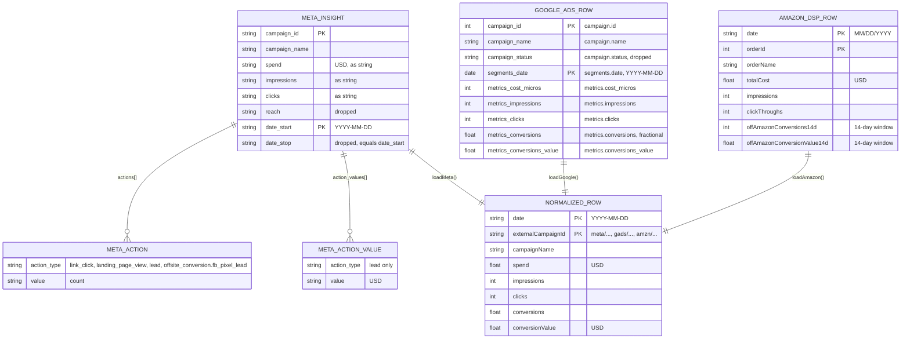
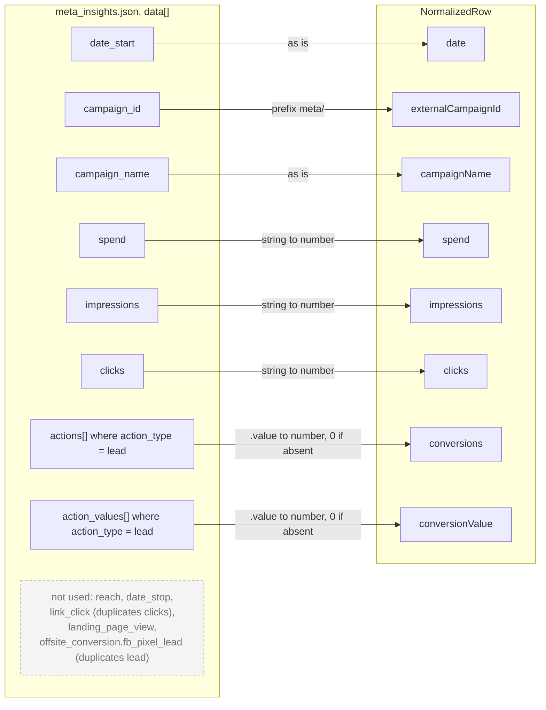
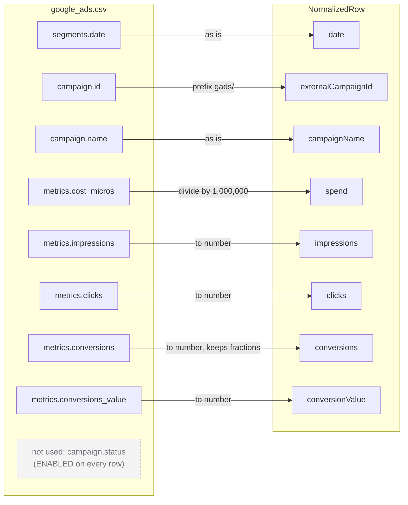
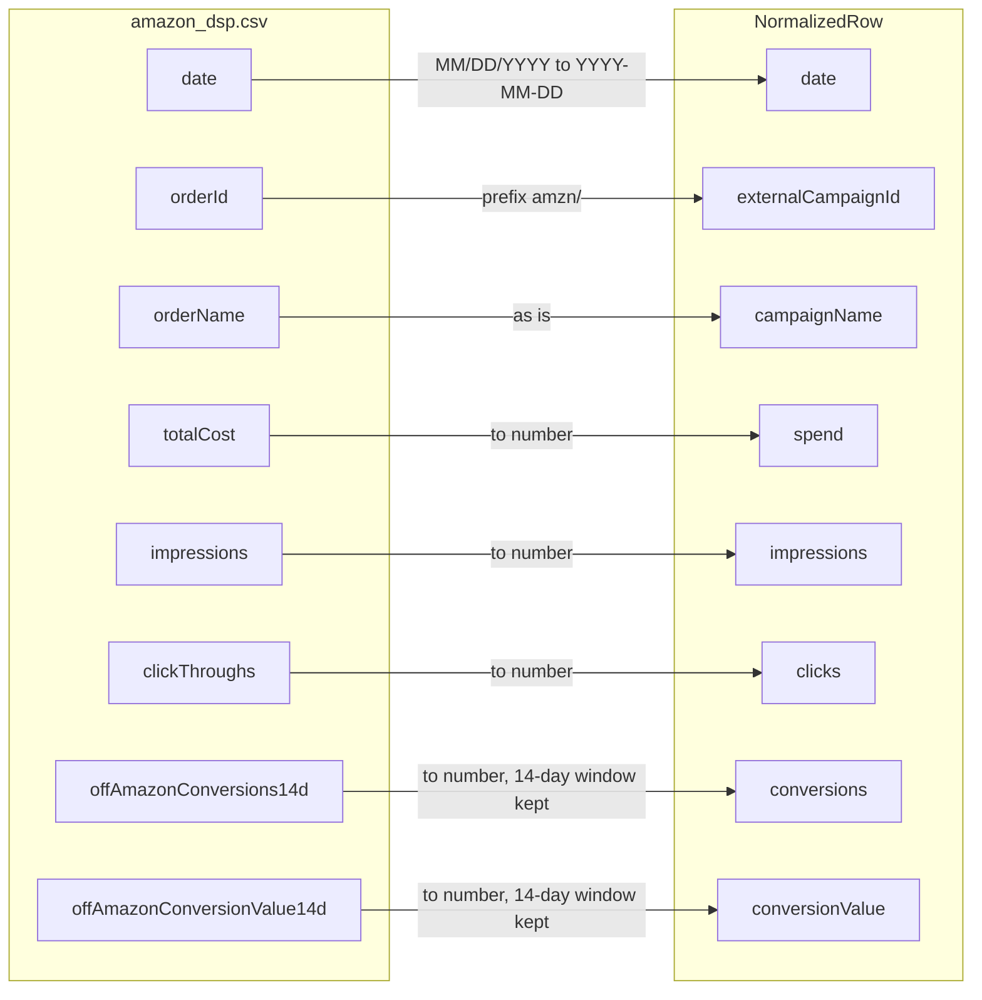

# Data model

Each platform export is loaded by `addPlatformDemo/src/lib/ingest.ts` into one `NormalizedRow` per
campaign per day. Grain is the same everywhere: one row = one campaign (Amazon: order) on one date.

There is no separate channel column. The channel is the prefix of `externalCampaignId`, written as
`{shortChannel}/{platform campaign id}` (`meta/31480986460544234`, `gads/43800084505`, `amzn/3779101165048`),
and `channelOf()` reads it back. This also keeps IDs unique across platforms.

## Source schemas and the normalized row

Attribute comments show the raw column name where it differs from the entity field.

## Column mapping: Meta

## Column mapping: Google Ads

## Column mapping: Amazon DSP

## Notes

- Any non-numeric value, malformed Amazon date or CSV row with the wrong column count throws at load time
  rather than becoming 0.
- Conversion windows are not harmonized: Amazon is 14-day off-Amazon, Meta and Google are each
  platform's default attribution. Cross-channel CPA and ROAS compare numbers counted differently.
